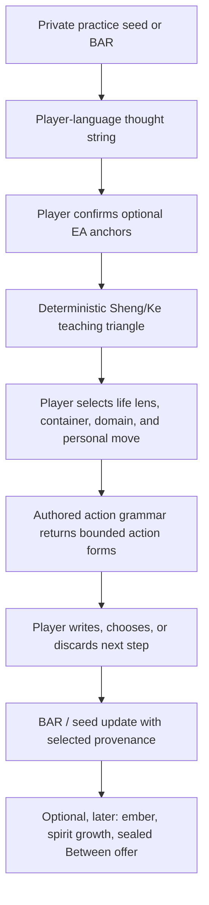

# Dojo Loop Library: From Charge to Grammatical Action

## Why this exists

The Triangle Workshop, Emotional Alchemy, BARs, spirits, the Nook, the Between, Lenses, allyship domains, personal moves, and Game Master faces are not separate games. They are a set of already-built primitives that need a clear, consentful wiring contract.

This document is the durable entry point for a future human or AI working on that wiring. It records **what is canonical**, **what must remain player-owned**, and **what the first demonstrable loop is**. It does not treat any system as a diagnosis engine, a replacement for judgment, or a claim that software has changed a person's energy.

## What has been established

### Thought Strings are the player-language grammar

- A word is player language: concept, felt tone, image, phrase, action, question, or emotion.
- Three player-selected words form a word-triangle; triangles chain and branch through shared words.
- A thought string is an evolving private pattern map, not an asserted causal model or a clinical profile.
- Reads belong to the player: **activation** (0–3) and **orientation** (`constricting`, `supportive`, `mixed`, `unread`). Do not collapse these into one moralized charge score.
- A word may remain unanchored. Its value does not depend on becoming an EA primitive.

### Emotional Alchemy is the canonical movement grammar

The current source of truth is `src/lib/quest-grammar/move-table.json`, represented in code by `src/lib/alchemy/alchemy-graph.ts`.

- Channels: Fear/Metal, Sadness/Water, Joy/Wood, Anger/Fire, Neutrality/Earth.
- Altitudes: dissatisfied, neutral, satisfied.
- Sheng moves preserve altitude and move forward through the five-element cycle.
- Ke moves preserve altitude and close a regulating edge.
- The full grammar supplies fifteen named canonical moves. It does **not** assign player words to channels.

### EA teaching triangles are deterministic overlays

An EA teaching triangle is available only after a player confirms all three same-altitude anchors:

```text
root → Sheng successor → that successor's Sheng successor
root → Ke-closing edge → final state
```

It is a lens on a thought string, never a replacement for the player-language string.

The first fixture is Metal/satisfied → Water/satisfied → Wood/satisfied:

```text
Wonder-Excitement / Metal
  -- Deepen Value --> Poignance / Water
  -- Renew Vitality --> Bliss / Wood
  -- Activate Hope --------------------------------> Bliss / Wood
```

See `elemental-triad-fixture.md` and `src/lib/alchemy/thought-string-triad.ts`.

### BARs hold the player-selected outward thread

A BAR is an agency and provenance object: the thing the player is making, tending, changing, or testing.

- A BAR is never required to begin dojo practice.
- A private practice seed may be discarded, settled, or deliberately planted as a BAR.
- A BAR may receive only selected word IDs, confirmed EA anchor IDs, selected move IDs, and an authored action summary.
- Raw harvest, private notes, 3-2-1 content, charge history, and daemon material never flow into a BAR, spirit, or Between automatically.

### The action stack has distinct layers

| Layer | Question | Example for a first dojo event |
|---|---|---|
| **Life lens** | Which part of life is this serving? | Career: learn event production / build an offering |
| **Container** | What kind of thing is being made or tended? | A three-person dojo gathering |
| **Allyship domain** | What work is this action doing now? | Skillful Organizing while designing the pilot |
| **Personal move** | How is the player practicing throughput? | Grow Up: build facilitation capacity |
| **EA move** | What transformation grammar is available? | Activate Hope |
| **Game Master face** | What optional agency style colors the practice? | Regent for bounded roles; Diplomat for the invitation |

The six Game Master faces are not life lenses or allyship domains. Existing `lens-moves.ts` uses legacy/misleading naming for face keys; preserve this distinction in any new dojo surface.

### Domains describe the current work, not the permanent identity of a project

“Create a gathering” can legitimately change domains as it comes alive:

| Current work | Allyship domain | Personal move |
|---|---|---|
| Design format, roles, run-of-show, RSVP, feedback loop | Skillful Organizing | Grow Up |
| Find participants, host, time, or venue | Gathering Resources | Open Up / Grow Up |
| Publish the invitation and make the offer legible | Raise Awareness | Wake Up / Show Up |
| Run the actual first session | Direct Action | Show Up |

One BAR may have a stable intent and move through these action phases. Do not force it into a single eternal domain.

## The loop



Every arrow is optional and reversible. The game makes availability legible; the player makes meaning and chooses action.

## First proof: the Dojo Loop Lab

Build a small, self-contained **Dojo Loop Lab** before persistence, AI interpretation, spirits, or the final Blender room.

### The authored scenario

> “I feel excitement and want to get this dojo idea in front of people.”

It starts with a player-language constellation:

`excitement → possibility → hope`

and offers optional buds:

`wonder → poignance → hope`

The scenario contains no claim that these words are automatically EA states.

### Player path

1. Mark a word read: activation and orientation.
2. Confirm, decline, or leave alone the proposed anchors for Wonder-Excitement/Metal, Poignance/Water, and Joy/Wood.
3. Observe the Metal → Water → Wood EA teaching triangle appear only when all three same-altitude anchors are confirmed.
4. See the exact available moves: Deepen Value, Renew Vitality, Activate Hope.
5. Choose a life lens: **Career**.
6. Choose the container: **small dojo gathering**.
7. Toggle the current work among domains to see grammatically different, deterministic action forms:
   - Skillful Organizing + Grow Up → draft 45-minute run-of-show, roles, capacity, one feedback question.
   - Gathering Resources + Open Up → identify and invite three suitable witnesses.
   - Raise Awareness + Wake Up → write a one-paragraph pilot invitation.
   - Direct Action + Show Up → host the scheduled pilot.
8. Choose, edit, or discard an action card.
9. Preview—not automatically create—the resulting BAR:

```ts
{
  title: 'Run a three-person dojo test',
  lifeLens: 'career',
  container: 'gathering',
  actionPhase: 'SKILLFUL_ORGANIZING',
  personalMove: 'grow_up',
  eaMoveId: 'metal_wood',
  actionForm: 'bounded_pilot_design',
  successCondition: 'A 45-minute pilot plan exists',
}
```

The player must press **Plant BAR** to persist it. In the Direct Action phase, success is “hosted the pilot,” never “three people attended” or “the event succeeded.”

### What the Lab proves

- Thought-string language can remain mixed, alive, and player-authored.
- EA can produce exact, reproducible movement options without interpreting words.
- Life lens, allyship domain, personal move, and GM face have non-overlapping jobs.
- One initiative can move through action phases without ontology drift.
- The system creates a bounded, player-controlled BAR rather than a generic motivational task.

### Explicit non-goals

- No AI assigns anchors, charge, domain, face, or action.
- No model generates a psychological interpretation.
- No raw reflection is persisted in the BAR preview.
- No reward is earned for intensity, disclosure, or selecting a difficult pattern.
- No spirit, daemon, ember, or Between effect occurs in this proof.

## Deterministic registry needed after the Lab

The Lab should use a tiny authored registry rather than an LLM:

```ts
type DojoActionGrammar = {
  version: 'v1'
  lifeLens: 'relationships' | 'career' | 'money' | 'health' | 'allyship'
  container: 'gathering'
  allyshipDomain: 'GATHERING_RESOURCES' | 'SKILLFUL_ORGANIZING' | 'RAISE_AWARENESS' | 'DIRECT_ACTION'
  personalMove: 'wake_up' | 'open_up' | 'clean_up' | 'grow_up' | 'show_up'
  eaMoveId: string
  actionForms: Array<{
    id: string
    verb: string
    requiredSlots: string[]
    playerControlCondition: string
    prompt: string
  }>
}
```

The resolver receives explicit IDs and returns stable, authored forms in a stable order. It cannot infer a domain from prose or choose a form on the player’s behalf.

## Source map

| Concern | Source |
|---|---|
| EA cycles and named moves | `src/lib/quest-grammar/move-table.json` |
| EA state/edge implementation | `src/lib/alchemy/alchemy-graph.ts` |
| Deterministic triad derivation | `src/lib/alchemy/thought-string-triad.ts` |
| First triad fixture and falsification cases | `elemental-triad-fixture.md` |
| Life Lenses domains | `src/lib/lenses/domains.ts` |
| Allyship domain definitions | `.specify/memory/allyship-domain-definitions.md` |
| Personal move / domain / GM-face distinctions | `.specify/memory/conceptual-model.md` |
| Existing domain + face move resolver | `src/lib/quest-grammar/resolveMoveForContext.ts` |

## Next build order

1. Run the unit fixture in a normal build environment and lock it as a CI check.
2. Build the self-contained Dojo Loop Lab with authored scenario data and no persistence. The implementation-ready expansion lives in [`../dojo-loop-lab/spec.md`](../dojo-loop-lab/spec.md).
3. Add the small `DojoActionGrammar` registry for the four gathering-phase forms.
4. Add a BAR-preview contract and prove discard / settle / plant behavior.
5. Replace the Lab scenario with live private practice only after its inputs, privacy, and action provenance are durable.
6. Add spirits and the Between only after the private loop is trustworthy.
